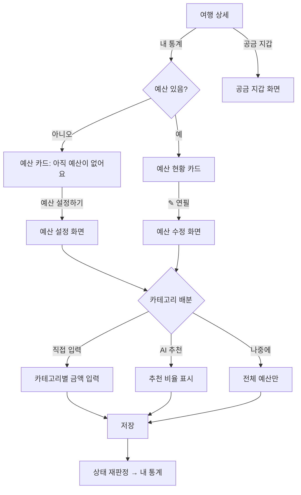
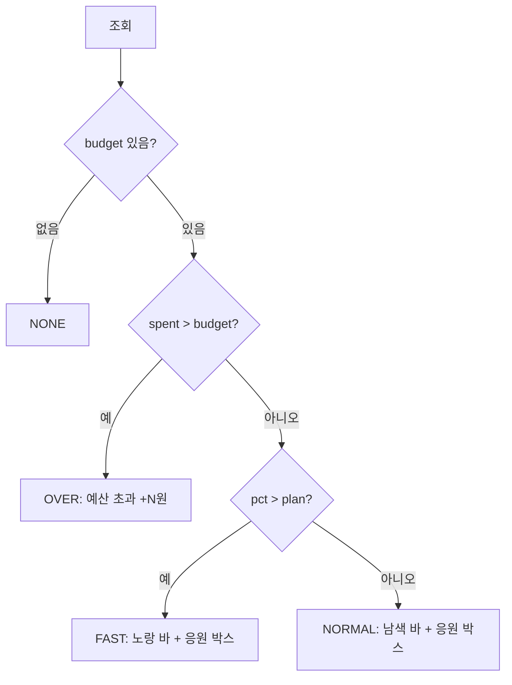
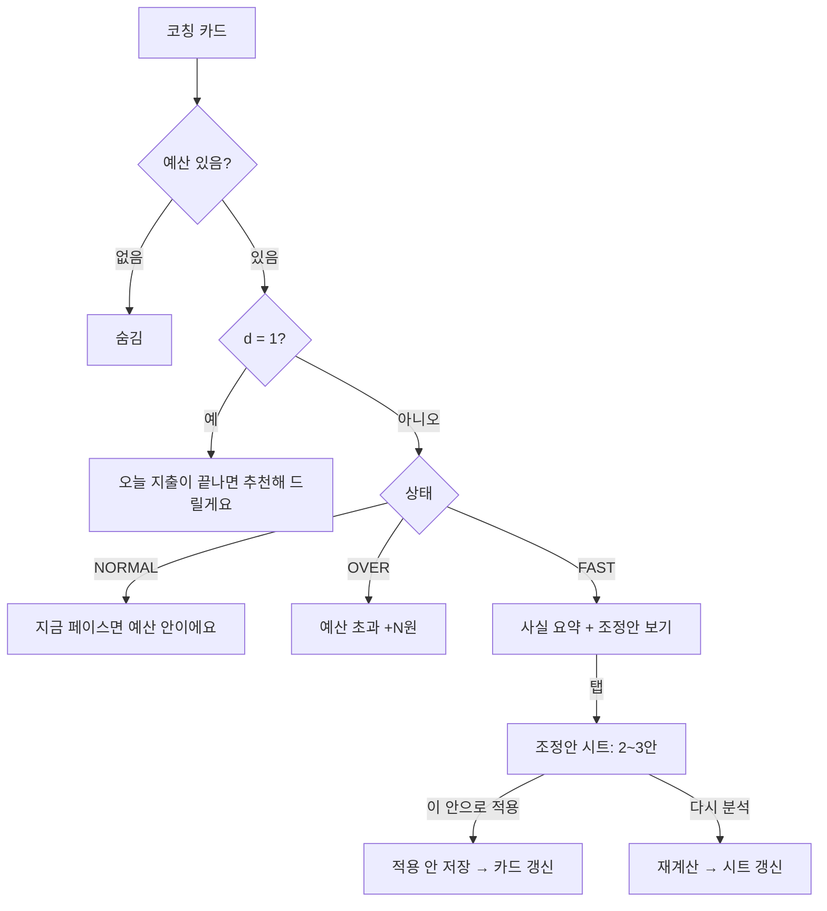
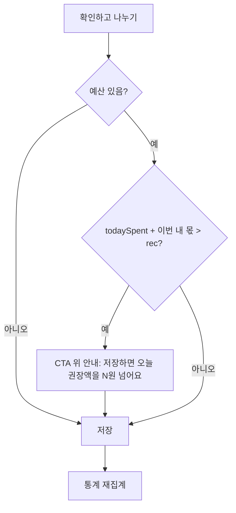

# Splito · 내 통계 — 기능명세서 & 플로우

- 디자인 레퍼런스: `Splito App.dc.html` › 1a 프로토타입 › **내 통계**, **예산 설정**, **공금 지갑**
  - 왼쪽 '데모 · 내 통계 예산'에서 예산 상태를 바꿔 볼 수 있음.
  - '데모 · 응원 문구'에서 응원 문구 버전을 바꿔 볼 수 있음.
- 예시 숫자는 모두 가짜 데이터.
- 작성 기준: 2026-11-03 설계 확정본

---

## 0. 원칙
| 항목 | 규칙 |
|---|---|
| 기준 금액 | **모든 금액은 내 몫 기준** = 공동 지출 중 내 분담액 + 나만 보기 지출 |
| 공개 범위 | 예산·코칭·통계는 **본인만** 볼 수 있다. 화면에 '나만 보여요' 같은 표시는 넣지 않는다. |
| 예산 제외 | 항공·숙박(패키지 선결제 포함, 카테고리 '숙소')은 예산 계산에서 뺀다. 카테고리별 지출에는 보여준다. |
| 계산 일관성 | 정산 계산과 통계 계산은 서로 독립이다. 일정 연결 여부는 계산에 영향을 주지 않는다. |
| 문구 톤 | 평가·경고 대신 사실과 긍정 표현을 쓴다. 예: "너무 많이 썼어요" ✕ → "남은 2일은 하루 ○원씩 쓰면 딱 맞아요" ○ |

## 1. 진입
- 여행 상세 › [내 통계] → 내 통계
- 예산이 없으면 예산 카드에서 [예산 설정하기] → 예산 설정(전체 화면)
- 공금 잔액은 내 통계에 없다. 여행 상세 › [공금 지갑]에서 본다(7장).

## 2. 화면 구성 (위 → 아래)
1. 헤더: ← / "내 통계"
2. 기간 칩: 전체 · 1일차 · 2일차 … (오늘 이후는 비활성)
3. 예산 현황 카드
4. AI 예산 코칭 카드
5. 전날 대비 카드
6. 카테고리별 지출 카드
7. 동행별 지출 카드

배경은 `#F5F7FB`, 카드는 흰색 + radius 20.

---

## 3. 예산 현황 카드

### 3-1. 상태 판정
```
budget  = 사용자가 정한 전체 예산 (항공·숙박 제외)
spent   = 여행 시작 ~ 지금, 예산 대상 내 몫 합계
N       = 여행 일수, d = 오늘이 몇 일차인지 (1..N)
plan    = (d − 0.5) / N            // 오늘 절반 시점까지의 계획 소진 비율
pct     = spent / budget

if budget 없음          → NONE
else if spent > budget  → OVER
else if pct > plan      → FAST   (계획보다 빠름)
else                    → NORMAL
```
> plan의 기준점(오늘 0.5일)은 조정 가능한 상수로 둔다. *(확인 필요)*

### 3-2. 상태별 UI
| 상태 | 보이는 요소 |
|---|---|
| NONE | "아직 예산이 없어요" + 안내 + [예산 설정하기] |
| NORMAL | 쓴 금액 · 진행 바 · 예산(✎) · 남은 금액 · 오늘 금액 박스 · 응원 박스(민트) |
| FAST | NORMAL과 같음. 진행 바 색과 응원 박스만 노랑. |
| OVER | **"예산 초과 +N원"**(빨강) + 빨간 바 + ✎. 다른 정보는 보여주지 않는다. |

### 3-3. 요소 상세
- **여행 중 쓴 금액**: `spent` (28/600)
- **진행 바**
  - 채움 너비 = `min(pct, 100%)`. 색: NORMAL `#1D3C8F`, FAST `#F5B400`
  - 계획 위치 = `plan`. 검정 **점선** 세로 마커만 그리고 라벨은 붙이지 않는다.
  - 범례: ■ "지출 금액 {pct}%"
- **예산 {budget}원 ✎**: 연필 → 예산 수정 화면
- **남은 금액**: `max(0, budget − spent)`. 한 줄로 보여준다(nowrap).
- **오늘 금액 박스** (`#F7F8FB` 바탕, 2열)
  - 왼쪽: 🪙 "오늘 남은 금액" — `max(0, rec − todaySpent)`, 22/600, `#C98A00`
  - 오른쪽: 📅 "하루 권장액" — `rec`, 17/600, 회색
  - 아래 막대: `todaySpent / rec` (최대 100%), `#F5B400`
  ```
  spentBeforeToday = 어제까지 예산 대상 내 몫 합계
  daysLeft         = N − d + 1           // 오늘 포함
  rec              = round100((budget − spentBeforeToday) / daysLeft)
  ```
- **응원 박스** (NORMAL·FAST만): 제목 1줄 + 설명 1줄. 문구는 아래 3-4. 둘 다 서버나 클라이언트 템플릿에서 숫자를 채운다.

### 3-4. 응원 문구 (버전 4종 · A/B 대상)
변수: `{per}` = round100(남은 금액 ÷ 남은 일수(오늘 제외)), `{tl}` = 오늘 남은 금액, `{remain}` = 남은 금액, `{n}` = 남은 일수(오늘 제외)

| # | FAST (노랑 · ✨) | NORMAL (민트 · ✔) |
|---|---|---|
| 1 | 계획보다 빠르게 쓰고 있어요. / 남은 {n}일은 하루 {per}씩 쓰면 딱 맞아요. | 이대로 쓰면 돼요. / 지금 속도면 예산 안에서 여행이 끝나요. |
| 2 | 아직 충분해요! / 남은 {n}일, 하루 {per}씩이면 예산 안에서 끝나요. | 여유 있어요! / 오늘 {tl} 더 써도 괜찮아요. |
| 3 | 조금만 나눠 쓰면 돼요. / 오늘은 {tl} 더 써도 괜찮아요. | 계획보다 아끼고 있어요. / 남은 {n}일은 하루 {per}까지 써도 돼요. |
| 4 | 예산 안에서 잘 가고 있어요. / 남은 {remain}으로 {n}일 더 즐겨요. | 잘하고 있어요. / 남은 {remain}, 마음 편히 즐겨요. |

- 마지막 날이라 `n = 0`이면 `{per}`가 들어간 문구는 쓰지 않는다. 버전 2·4로 대체한다.
- FAST 3번은 `tl = 0`이면 쓰지 않는다.

## 4. 예산 설정 / 수정 (전체 화면)
- 진입: NONE의 [예산 설정하기] → 제목 "여행 예산을 정해 주세요" + 안내 / ✎ → 제목 "예산 수정"
- 필드
  - 전체 예산(원): 숫자만 받고 천 단위 콤마 표시. 1원 이상. 안내 "항공·숙박료는 빼고 입력해 주세요"
  - 카테고리 배분(선택) 세그먼트: **직접 입력 / AI 추천 받기 / 나중에**
    - 직접 입력: 식비·교통·쇼핑·관광·기타 금액 입력. 합계가 전체 예산과 다르면 안내만 하고 막지는 않는다. *(확인 필요)*
    - AI 추천: 지금까지 지출 패턴(없으면 여행지 평균)으로 비율 제안. 예: 38 / 8 / 30 / 20 / 4%
    - 나중에: 전체 예산만 저장
- [저장] → 내 통계로 돌아감 + 토스트 "예산을 저장했어요". 다음 조회부터 상태를 다시 판정한다.
- 여행 만들기·초대 단계에서는 예산 설정을 노출하지 않는다.

## 5. AI 예산 코칭 카드
| 조건 | 표시 | 탭 |
|---|---|---|
| NONE | 카드 숨김 | – |
| d = 1 | "오늘 지출이 끝나면 추천해 드릴게요" | 없음 |
| NORMAL (d ≥ 2) | "지금 페이스면 예산 안이에요" + 요약 1문장 | 없음 |
| FAST (d ≥ 2) | 사실 요약 1~2문장 + "조정안 보기 ›" | 조정안 시트 |
| OVER | "예산 초과 +N원"만 (빨강) | 없음 |
| 조정안 적용 후 | "‘{안 이름}’ 안을 적용했어요" + 기준 금액 | 조정안 시트 |

**조정안 시트**
- 제목: "남은 {n}일 조정안" / "하루 {per}이면 예산 안이에요"
- 카드 2~3개 중 하나 선택(라디오)
  - 쇼핑 지키기
  - 식비 지키기
  - 골고루 줄이기
- 카드마다 카테고리별 **하루 금액**(식비·교통·쇼핑·관광·기타)을 보여준다. 각 안의 합계 = `{per}`.
- [다시 분석] → 최신 지출로 다시 계산 + 토스트 / [이 안으로 적용] → 시트 닫기 + 카드 문구 갱신 + 토스트
- 적용한 안은 카테고리별 하루 기준으로 저장한다. 지출 저장 경고(8장)에 쓸 수 있다.

## 6. 통계 카드

### 6-1. 전날 대비
- 기준: **숙소 제외**, 내 몫. (화면에 '전날 대비'·'숙소 제외' 라벨은 표시하지 않음)
- 문장은 두 줄로: "어제보다 {|diff|}원" / "{더|덜} 썼어요 ({±%})"
  - `diff = today − yesterday`, `% = round(diff / yesterday × 100)`
- d = 1이거나 1일차 필터면 "여행 첫날이에요"
- 막대 그래프: 일차별 금액. 오늘 막대는 진하게, 미래는 점선 빈 막대.
  - 하루 권장 기준선(노란 점선) = `budget / N`. 예산이 없으면 그리지 않는다.
  - 기간 칩으로 일차를 고르면 그 막대만 강조한다.

### 6-2. 카테고리별 지출
- 식비 · 교통 · 숙소 · 쇼핑 · 관광 · 기타. 금액 + 비율(전체 대비) 가로 막대. 금액이 큰 순서로 정렬한다.
- 기간 칩에 따라 집계한다(전체/일차).
- 행을 탭하면 바텀시트로 해당 카테고리 지출 목록을 보여준다(내 몫, 날짜·결제자). 비어 있으면 "이 기간에는 지출이 없어요".

### 6-3. 동행별 지출 (참여자 2명 이상일 때만)
- 집계 대상: **공동 지출만**(화면에는 라벨 없음)
- 사람마다 막대 2개: **결제한 돈**(`#1D3C8F`) / **쓴 돈 = 분담액**(`#C2CFE8`). 최댓값 기준으로 정규화한다.
- 게스트도 한 명으로 보여준다(이름 아래 표기).

## 7. 공금 지갑 (내 통계에서 이동)
- 진입: 여행 상세 › [공금 지갑]. 공금 기능이 켜진 방만.
- 잔액 카드(민트): 현지 통화 + 원화, 진행 바(사용 비율), "모은 돈 · 쓴 돈". 동행 모두 같은 값을 본다.
- 공금 내역 목록: 모으기(+, 민트) / 사용(−). 날짜·제목·금액.

## 8. 지출 저장 연동
- 카테고리 칩: AI가 자동으로 고르고, 사용자가 수정할 수 있다. 바꾸면 "직접 고쳤어요"로 표시.
- 저장하면 오늘 권장액을 넘을 것 같을 때 CTA 위에 한 줄 안내를 띄운다.
  - 예: "저장하면 오늘 권장액을 12,000원 넘어요"
  - 저장은 막지 않는다. 예산이 없으면 띄우지 않는다.

---

## 9. 플로우차트

### 9-1. 진입과 예산 설정


### 9-2. 예산 상태 판정


### 9-3. AI 예산 코칭


### 9-4. 지출 저장 시 예산 안내


---

## 10. 데이터 / API (제안)
```
trip_budget  { trip_id, user_id, total, alloc_mode:'manual'|'ai'|'none',
               alloc:{식비,교통,쇼핑,관광,기타}, applied_plan_id, updated_at }   -- 사용자별
GET /trips/:id/stats?day=all|1..N
  → { budget, spent, spentBeforeToday, todaySpent, N, d, state,
      rec, remain, pct, plan,
      daily:[{day, amount}], categories:[{cat, amount}], mates:[{user, paid, share}],
      coach:{ type, title, sub, plans:[{id,title,desc,perDay:{...}}] } }
POST /trips/:id/budget        { total, alloc_mode, alloc }
POST /trips/:id/coach/apply   { plan_id }
POST /trips/:id/coach/refresh
```
- 통계는 지출이 추가·수정·삭제될 때마다 다시 계산한다(캐시 무효화).
- 시간대: 여행지 현지 시간으로 '오늘'을 나눈다.

## 11. 예외 처리
| 케이스 | 처리 |
|---|---|
| 여행 시작 전 (d < 1) | 예산 카드만 보여준다. spent = 0, 코칭은 "여행이 시작되면 알려드릴게요" *(확인 필요)* |
| 여행 종료 후 (d > N) | `daysLeft = 0` → 오늘 금액 박스를 숨기고, 결과 요약으로 대체 *(확인 필요)* |
| 지출 0건 | 그래프·카테고리 빈 상태 "아직 지출이 없어요" |
| 예산 < 이미 쓴 금액으로 수정 | 저장 허용 → 바로 OVER |
| 외화 지출 | 결제일 환율로 원화 확정값 사용(정산과 동일) |
| 참여자 1명 | 동행별 지출 카드 숨김 |
| 나만 보기 지출 | 내 몫 100%로 포함, 동행별 지출(공동)에서는 제외 |

## 12. 확인 필요
1. plan 기준점(오늘 0.5일) 상수
2. 직접 입력 배분 합계가 전체 예산과 다를 때의 처리
3. 여행 시작 전·종료 후 화면
4. 응원 문구 최종 버전(A/B 여부)
5. 조정안 개수(2개 또는 3개)와 생성 규칙(AI 프롬프트 · 룰)
